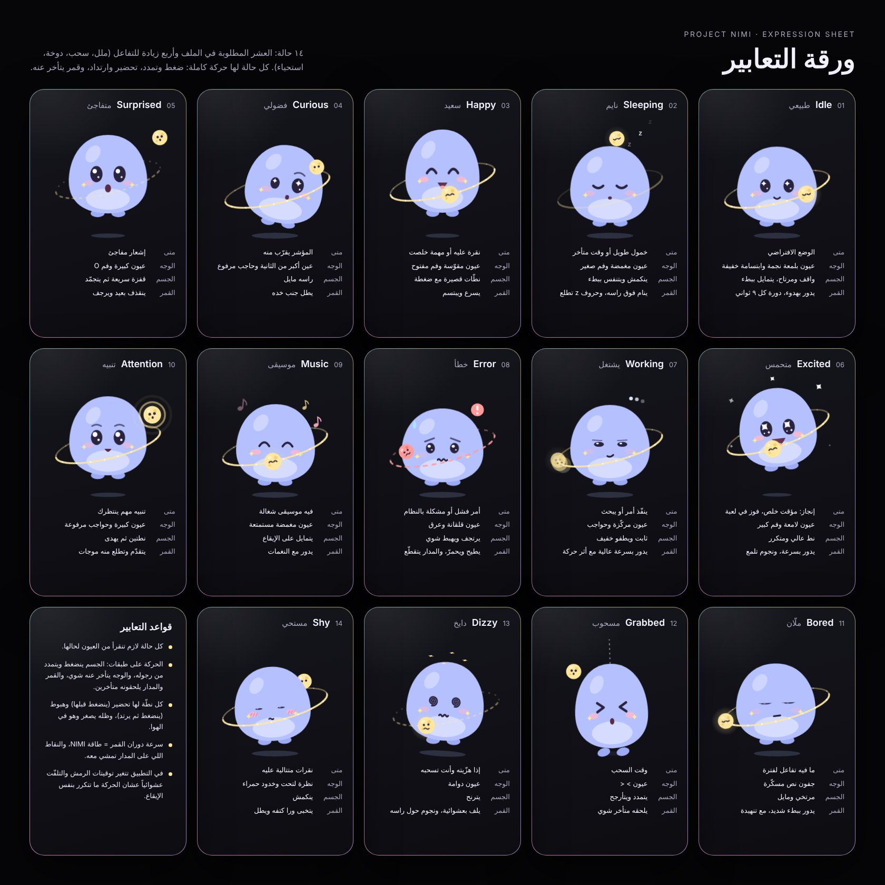
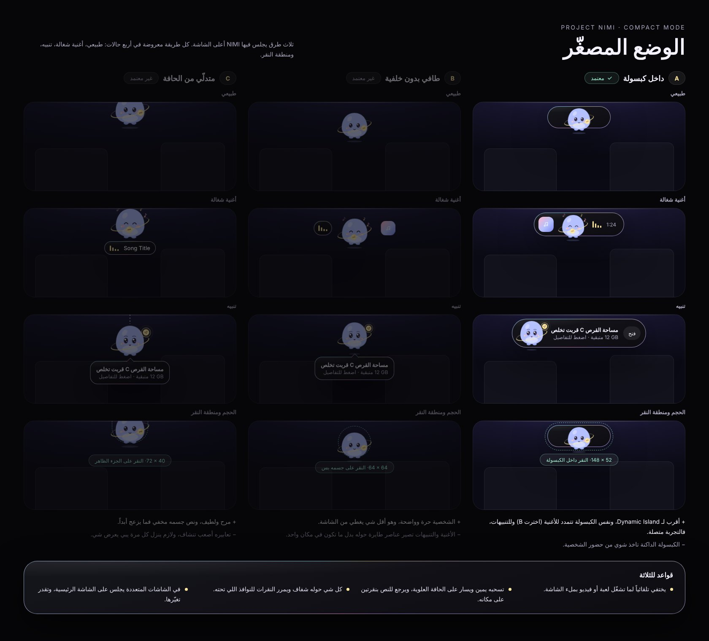
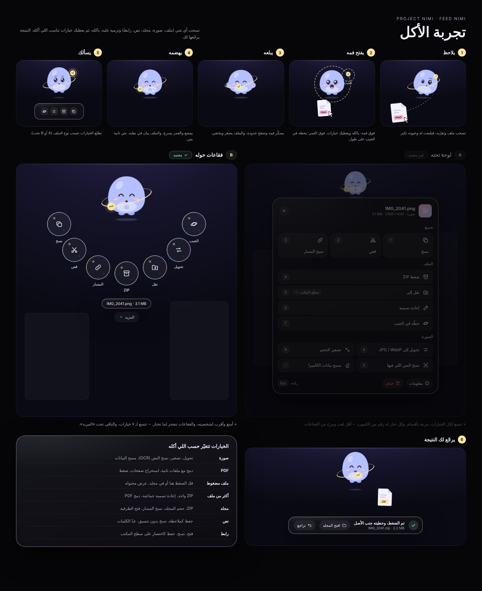
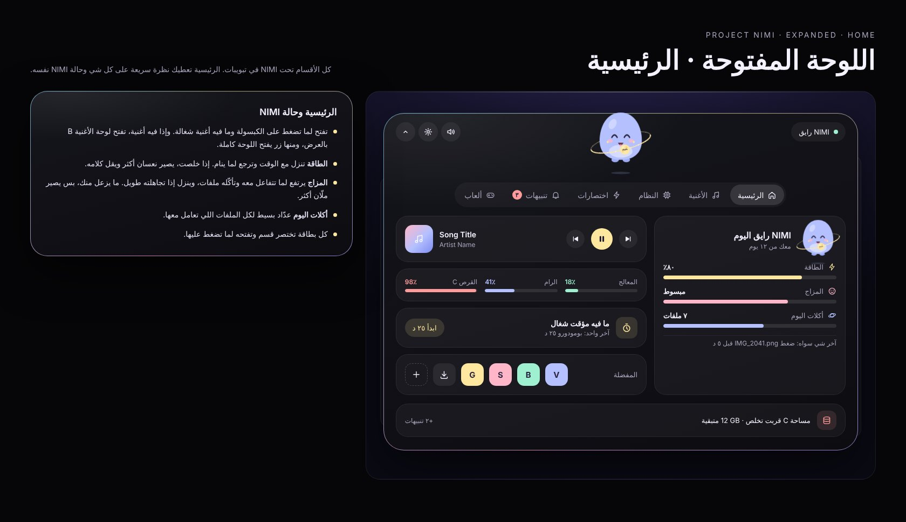
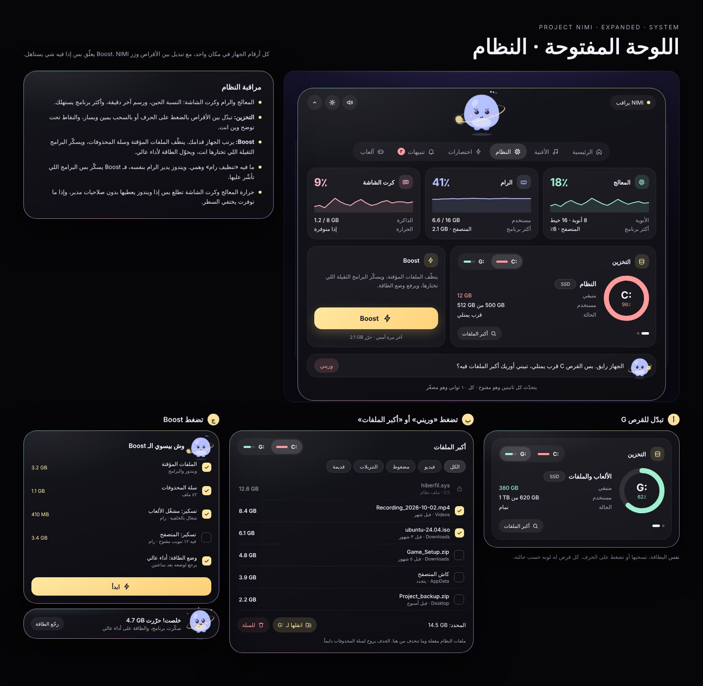
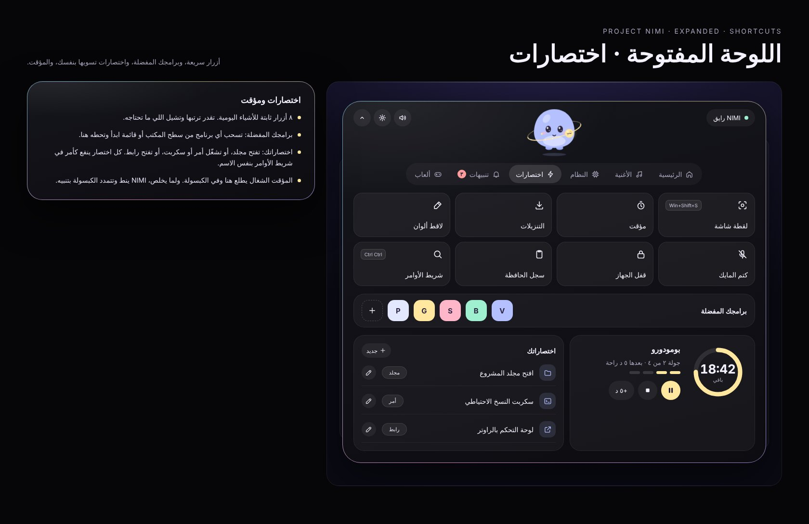
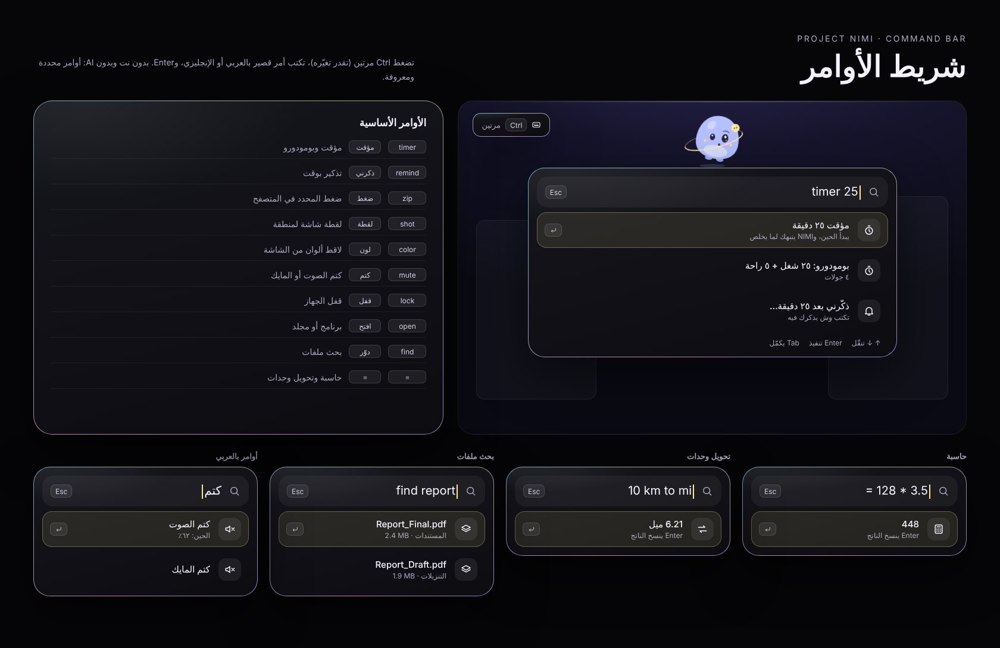
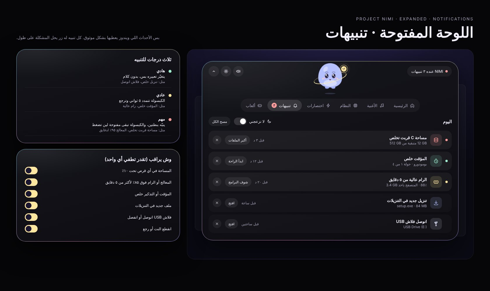
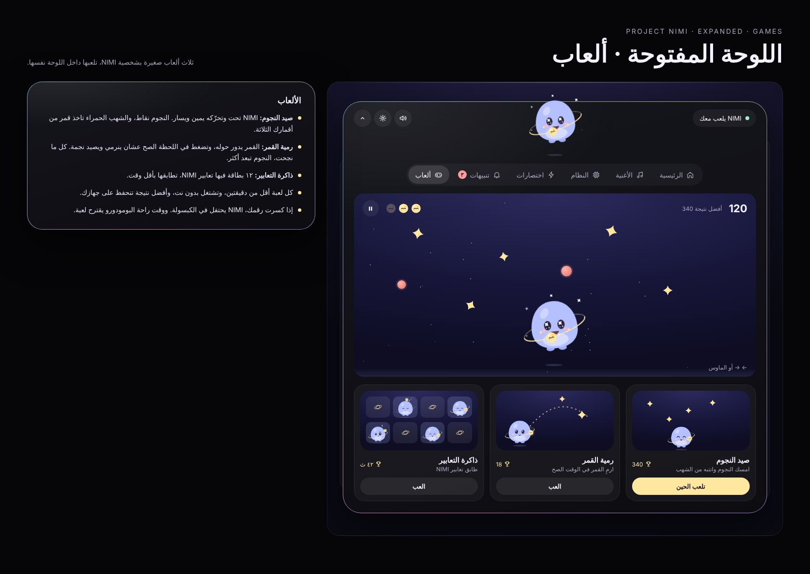
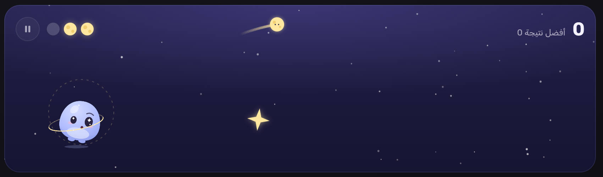

<div align="center">


# NIMI · نيمي

**رفيق صغير يعيش فوق شاشتك** · **A little companion that lives on top of your screen**

Windows 10 / 11 · عربي + English · 100% offline

[**⬇ تحميل · Download**](https://github.com/kai39x/nimi/releases/latest) &nbsp;·&nbsp; [العربية](#ar) &nbsp;·&nbsp; [English](#en)



</div>

---

<a id="ar"></a>

<div dir="rtl">

## نيمي بالعربي

نيمي شخصية لطيفة تسكن في كبسولة زجاجية صغيرة فوق نص الشاشة، ومعه قمره «نوري» يدور حوله. يحس ويتفاعل معك: ينعس إذا ما لعبت معه، يفرح إذا أطعمته ملف، ويتحمّس إذا كسرت رقمك في لعبة. وفي نفس الوقت أداة عملية: يشغّل أغانيك، يراقب جهازك، يحوّل ملفاتك، ويختصر عليك شغل كثير.

كل شي يشتغل **على جهازك** بدون نت ولا حسابات ولا تتبع.

### وش يسوي

| | |
|---|---|
| 🫧 **الشخصية** | ٢٤ تعبير، وحركة ناعمة، ونوري يدور من قدامه ومن وراه. يرمش ويلتفت وينعس ويصحى، وفي الشتاء يلبس طاقية وشال. |
| 🎵 **الأغاني** | يعرض الأغنية الشغالة من أي برنامج. تقدّم وترجّع وتغيّر الصوت بعجلة الماوس فوق الكبسولة. |
| 🍽️ **الأكل والجيب** | اسحب أي ملف عليه: يحوّل الصور (PNG / JPG / WebP / PDF / ICO)، يقرأ النص من الصور، يدمج ويصغّر الـ PDF، يضغط ZIP ويفك، يفحص الروابط قبل ما تفتحها. أو حطه في «الجيب» عند نوري لين تحتاجه. |
| 💻 **النظام** | المعالج والرام وكرت الشاشة، مساحة كل قرص، أكبر الملفات، و«تسريع» يقفل بس البرامج اللي تختارها. |
| ⚡ **الاختصارات** | لقطة شاشة، مؤقت وبومودورو، لاقط ألوان، سجل الحافظة، كتم المايك، قفل الجهاز، برامجك المفضلة واختصاراتك الخاصة. |
| ⌨️ **شريط الأوامر** | اضغط Ctrl مرتين واكتب بالعربي أو الإنجليزي: `مؤقت 25`، `ذكرني 10 اشرب موية`، `= 128 * 3.5`، `10 km to mi`، `افتح`، `دوّر`. |
| 🔔 **التنبيهات** | يقولك إذا القرص قرب يمتلي، أو جهازك مضغوط، أو خلص المؤقت، أو نزل ملف، أو انوصل فلاش، أو انقطع النت. ثلاث درجات و«لا تزعجني». |
| 🎮 **الألعاب** | صيد النجوم، رمية القمر، وذاكرة التعابير. كل لعبة أقل من دقيقتين. |

### صور

الصور من لوحات التصميم المعتمدة، والبرنامج مطابق لها شاشة شاشة.

<p align="center">








</p>

<p align="center"><br/><sub>رمية القمر، لقطة من البرنامج نفسه</sub></p>

### التحميل

من [صفحة الإصدارات](https://github.com/kai39x/nimi/releases/latest):

- **`NIMI_x.y.z_x64-setup.exe`**: ملف تثبيت، يتثبّت لحسابك بدون صلاحيات مدير.
- **`NIMI_x.y.z_portable.exe`**: نسخة محمولة، تشغّلها على طول بدون تثبيت.

يحتاج ويندوز ١٠ أو ١١. أول مرة تشغّله، نيمي بنفسه يعرّفك على نفسه بجولة أقل من دقيقة.

> البرنامج مو موقّع رقمياً، فممكن ويندوز يطلع لك تنبيه «Windows protected your PC». اضغط «More info» ثم «Run anyway».

### الخصوصية

- كل شي محلي: ما فيه حسابات، ولا تتبع، ولا ذكاء اصطناعي، ولا يرسل أي بيانات.
- الشي الوحيد اللي يستخدم النت، وهو مطفي من البداية: قائمة OpenPhish لفحص الروابط. تنزل مرة باليوم إذا شغّلتها، والفحص كله يصير على جهازك.
- سجل الحافظة في الذاكرة بس، وينمسح لما تقفل نيمي. كلمات السر من مدير كلمات السر ما تنحفظ.
- الحذف دايم يروح لسلة المحذوفات.

</div>

---

<a id="en"></a>

## NIMI in English

NIMI is a cute character who lives in a small glass capsule at the top center of your screen, with his moon **Nuri** circling him. He reacts to you: he gets sleepy when ignored, happy when you feed him a file, and thrilled when you beat your record in a game. He is also a genuinely useful tool: he plays your music, watches your PC, converts your files and saves you lots of small chores.

Everything runs **on your PC** — no internet, no accounts, no tracking.

### What he does

| | |
|---|---|
| 🫧 **Character** | 24 expressions, soft spring motion, Nuri orbiting in front of and behind him. He blinks, glances, dozes off and wakes up — and wears a hat and scarf in winter. |
| 🎵 **Music** | Shows what's playing in any app (Windows media controls). Seek, skip, and change the volume with the mouse wheel over the capsule. |
| 🍽️ **Feeding & pocket** | Drop any file on him: convert images (PNG / JPG / WebP / PDF / ICO), copy text from images (OCR), merge / split / compress PDFs, ZIP and unzip, check links before you open them. Or drop it on Nuri to keep it in the pocket for later. |
| 💻 **System** | CPU, RAM and GPU, every drive's free space, your largest files, and a Boost that only closes the apps you tick. |
| ⚡ **Shortcuts** | Screenshot, timer & Pomodoro, color picker, clipboard history, mute mic, lock PC, favorite apps and your own shortcuts. |
| ⌨️ **Command bar** | Tap Ctrl twice and type in English or Arabic: `timer 25`, `remind 10 drink water`, `= 128 * 3.5`, `10 km to mi`, `open`, `find`. |
| 🔔 **Notifications** | Drive almost full, PC under load, timer done, new download, USB in / out, internet lost — three levels and Do Not Disturb. |
| 🎮 **Games** | Star Catch, Moon Toss and Expression Memory — each under two minutes. |

The screenshots above are the approved design boards; the app follows them screen by screen.

### Download

From the [releases page](https://github.com/kai39x/nimi/releases/latest):

- **`NIMI_x.y.z_x64-setup.exe`** — installer (per-user, no admin rights).
- **`NIMI_x.y.z_portable.exe`** — portable, runs without installing.

Requires Windows 10 or 11. On first launch NIMI introduces himself in a tour that takes under a minute.

> The app isn't code-signed, so Windows may show "Windows protected your PC". Click **More info → Run anyway**.

### Privacy

- Fully local: no accounts, no telemetry, no AI, no data sent anywhere.
- The only network use is opt-in and off by default: the OpenPhish phishing list for link checks, downloaded once a day and matched on your PC.
- Clipboard history lives in memory only and is gone when NIMI quits; password-manager copies are never kept.
- Deleting always goes to the Recycle Bin.

### Build from source

Needs Node.js (LTS), Rust (MSVC toolchain) and the WebView2 runtime.

```bash
npm ci
npm run tauri dev      # run with hot reload
npm run tauri build    # NSIS installer + exe in src-tauri/target/release
```

Built with [Tauri 2](https://tauri.app), React 19 and TypeScript. Font: Rubik (OFL). More in [`CLAUDE.md`](CLAUDE.md) and [`docs/`](docs/).

### License

[MIT](LICENSE) © 2026 kai
